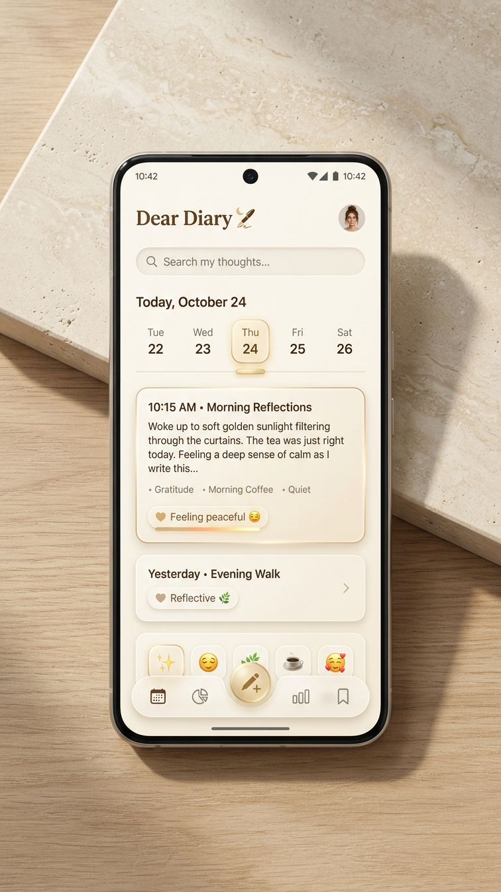
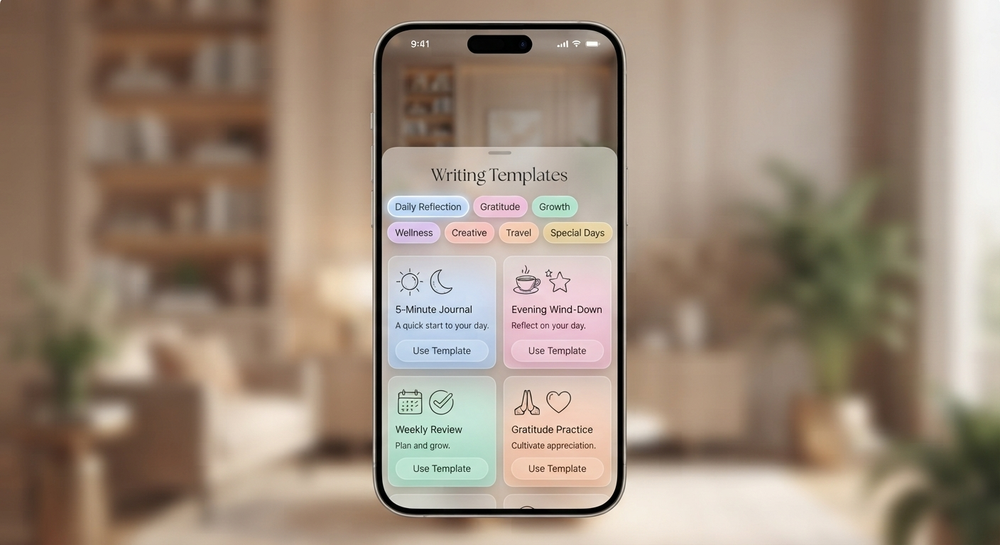
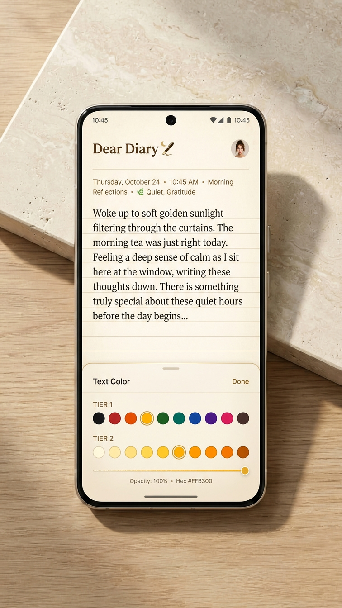
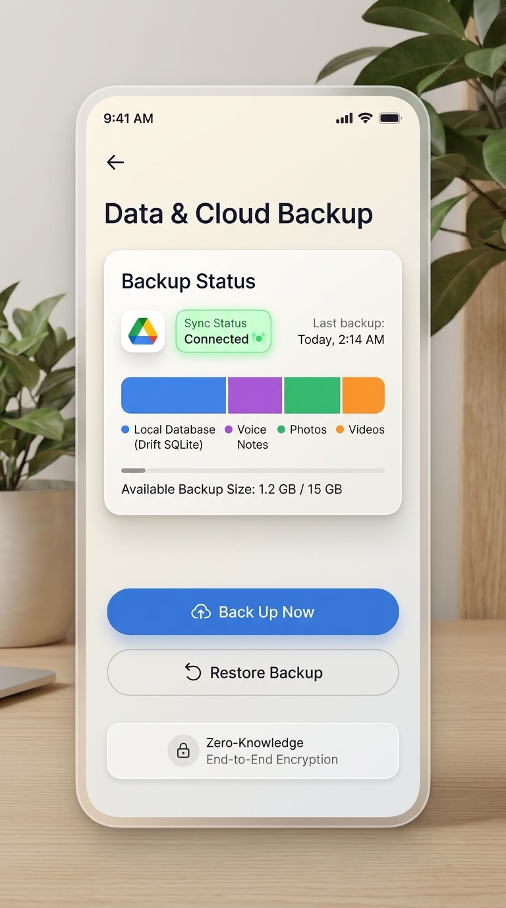

# 📔 Dear Diary — Vintage Frosted Glass Journal & AI Companion

[](https://github.com/B-max12/dear_diary)
[](https://flutter.dev)
[](https://github.com/B-max12/dear_diary/releases)
[](LICENSE)
[](https://github.com/B-max12/dear_diary)

> **A tranquil, privacy-first personal sanctuary crafted with frosted glassmorphism, 31 StoryPad structured writing templates, real-time device-to-device (D2D) sync, WhatsApp-style Google Drive cloud backup, 15 dynamic launcher icons, 25 ambient relaxation tracks, lifetime wax seal locking, and Safina AI reflection.**

Repository: [https://github.com/B-max12/dear_diary.git](https://github.com/B-max12/dear_diary.git)

---

## 📸 Visual Showcase & Interface Preview

<p align="center">
  
</p>

| 📱 Frosted Glass Timeline | 📝 Dear Diary Templates | 🎨 Customization Studio |
| :---: | :---: | :---: |
|  |  |  |

| ✍️ Docked Rich Text Editor | 🎵 Ambient Sounds Mixer | ☁️ WhatsApp-Style Backup |
| :---: | :---: | :---: |
|  |  |  |

---

## ✨ Key Highlights in v5.0.0

- 🪟 **Complete Frosted Glassmorphism UI**: High-fidelity optical blurs (`BackdropFilter`), dual-mode translucent gradient containers (light & dark parchment glass), subtle specular rim highlights, and tactile 3D polymorphic buttons.
- 📋 **Dear-Diary Writing Templates Suite (31 Templates across 7 Categories)**: Instant structured prompt sheets for *Daily Reflection*, *Gratitude*, *Productivity*, *Wellness*, *Creative*, *Travel*, and *Special Days*. Seamless 1-tap insert & replace in the editor.
- ⚡ **Real-Time Device-to-Device (D2D) Sync**: Type on your phone and see your text update simultaneously on desktop in real-time over Wi-Fi and mobile data via Supabase Realtime broadcast channels.
- 💾 **WhatsApp-Style Full Cloud Backup & Restore**: Effortless 1-tap GZip-compressed backup to your private Google Drive `appDataFolder`. Restores every entry, tag, mood, photo, voice note, video, document, Gratitude Jar, and Time Capsule exactly as you left it.
- 📱 **15 Custom App Launcher Icons & Live App Renaming**: Choose from 15 custom handcrafted icon designs and custom app names that immediately update your Android home screen launcher via dynamic `<activity-alias>` switches.
- 🪟 **Android 8+ Floating Window & Split-Screen Multi-Tasking**: Fully responsive layout optimized for multi-window and floating popups without blank screen rendering glitches (Impeller disabled on floating surfaces).
- 🪶 **Optimized APK Footprint**: Losslessly compressed from 205MB down to **108.5MB** through automated palette-optimized GIF encoding and asset pruning.
- 🎵 **25-Track StoryPad Relaxing Sounds & Mixer**: Layer rain, forest birds, wind chimes, waves, and campfire with individual volume sliders, sleep timer, and live floating music pill.
- 🔒 **Zero-Knowledge Privacy & Lifetime Wax Seal Stamping**: AES-256 client-side encryption for confidential notes and physical wax seal simulation that permanently locks pages into immutable read-only records.

## 🏗️ Technical Architecture

Dear Diary is engineered from the ground up for **extreme offline resilience, multi-platform fluidity, and uncompromising privacy**:

```
┌────────────────────────────────────────────────────────────────────────┐
│                        Dear Diary Client (Local)                       │
│                                                                        │
│   Flutter UI Layer (Frosted Glassmorphism, Quill Editor, 3D Docks)     │
│        │                                                               │
│        ▼                                                               │
│   Riverpod State Layer (Customizations, SyncEngine, RelaxingSounds)    │
│        │                                                               │
│        ▼                                                               │
│   Local SQLite Database (Drift Engine) ◄── PRIMARY SOURCE OF TRUTH    │
│   Local Media Storage   (Encrypted / Scaled Filesystem Cache)          │
└───────────────────┬───────────────────────────────┬────────────────────┘
                    │                               │
        Realtime Keystroke CDC           GZip Full Snapshot Sync
                    │                               │
                    ▼                               ▼
      ┌───────────────────────────┐   ┌───────────────────────────┐
      │  Supabase Cloud (Remote)  │   │     Google Drive Cloud    │
      │  • Hardware-backed JWT    │   │  • appDataFolder Sandbox  │
      │  • Realtime Broadcast     │   │  • Encrypted .json.gz     │
      │  • Row Level Security     │   │  • Zero-Quota Footprint   │
      └───────────────────────────┘   └───────────────────────────┘
```

### Architectural Principles:
1. **Local-First Supremacy**: Every keystroke, photo, voice recording, and tag is instantly written to local SQLite via Drift and the device filesystem. The app opens and functions instantly with zero network connectivity.
2. **Real-Time Cross-Device Broadcasting**: Uses Supabase Realtime WebSocket broadcast channels to reflect drafts and committed edits across phones and desktops instantaneously.
3. **WhatsApp-Style Portable Cloud Snapshots**: Full diary state (entries, tags, moods, attachments, jars, time capsules, and settings) is bundled into compact GZip `.json.gz` archives and stored in your own Google Drive application sandbox.
4. **Permanent Immutability**: Wax-sealed records cannot be edited or altered after stamping, guaranteed both locally in SQLite and remotely via PostgreSQL triggers.

---

## 📂 Project Structure

```
dear_diary/
├── android/                  # Android native project, activity-aliases & manifest
├── assets/
│   ├── app_icons/            # 15 custom launcher icon assets
│   ├── icons/                # Compressed animated GIF icon collection (4.1MB)
│   ├── images/               # Paper textures, wax seals, and illustrations
│   └── sounds/               # Bundled offline ambient sound fallbacks
├── lib/
│   ├── core/                 # Routing, theme, localization, constants, and utilities
│   ├── data/                 # Drift SQLite database, repositories, and sync engine
│   ├── domain/               # Entities (WritingTemplate, Customizations, Entries)
│   ├── presentation/
│   │   ├── controllers/      # Riverpod controllers & state notifiers
│   │   ├── providers/        # Dependency injection & reactive providers
│   │   ├── screens/
│   │   │   ├── diary/        # Entry editor & entry list screens
│   │   │   ├── home/         # HomeShell, bottom bar dock & TodayScreen
│   │   │   ├── map/          # World Footsteps interactive map
│   │   │   ├── settings/     # Customizations, Data & Backup, Storage screens
│   │   │   └── templates/    # StoryPad Templates Hub & Custom Editor
│   │   └── widgets/          # Glassmorphic EntryCard, Toolbar, Sound mixer, Sheets
│   └── services/             # Audio, AI (Safina), Google Drive, and Security
├── test/                     # Unit, widget, and integration test suites
└── pubspec.yaml              # Dependencies and asset declarations
```

---

## 🚀 Getting Started & Installation

### Prerequisites
- **Flutter SDK**: `>= 3.24.0`
- **Dart SDK**: `>= 3.5.0`
- **Android SDK**: `API Level 26+` (Android 8.0 Oreo or higher)

### Setup Instructions

1. **Clone the repository**:
   ```bash
   git clone https://github.com/B-max12/dear_diary.git
   cd dear_diary
   ```

2. **Install Flutter dependencies**:
   ```bash
   flutter pub get
   ```

3. **Verify analyzer health**:
   ```bash
   flutter analyze
   ```
   *(Ensure 0 warnings and 0 errors).*

4. **Run the test suite**:
   ```bash
   flutter test
   ```

5. **Run the app locally**:
   ```bash
   flutter run
   ```

### 📦 Building Release APK

To generate the production release APK (optimized under 120MB):

```bash
flutter build apk --release
```

The compiled APK will be located at:
```
build/app/outputs/flutter-apk/app-release.apk
```

---

## 📜 Complete Feature Catalog

<details>
<summary><b>Click to expand the 12 feature suites in Dear Diary</b></summary>

### 1. 🖋️ Core Journaling & Frosted Glass Dashboard
- **Glassmorphic Timeline**: Chronological memory feed with frosted glass cards, day-color glows, and smooth scroll retention.
- **StoryPad Writing Templates**: 31 pre-built structured templates across 7 categories (Daily Reflection, Gratitude, Growth, Wellness, Creative, Travel, Special Days) with 1-tap insert and replace.
- **Bottom Docked RichTextToolbar**: Docked right above the mobile keyboard with Bold, Italic, Underline, Strikethrough, Heading styles, Quotes, Checklists, Undo/Redo, and 100-shade color picker.
- **Unified Media Attachment**: Single button to embed Photos, Voice Notes, High-Res Videos, and Documents (PDF, Word, Excel, TXT) inline into entries.

### 2. 🎵 25-Track Ambient Sound Studio
- **Curated Atmosphere**: Rain, Thunderstorm, Ocean Waves, Stream, Forest Birds, Night Crickets, Wind Chime, Singing Bowl, Campfire, Old Café, White Noise, and more.
- **Multi-Track Mixing**: Play up to 5 tracks simultaneously with custom volume levels per track.
- **Sleep Timer**: Auto-fade timers (15m, 30m, 45m, 60m) with live countdown in the floating header pill.

### 3. 🏺 Keepsakes & Nostalgia
- **Gratitude Jar**: Animated tied parchment scroll drops into an antique jar; jars automatically seal at 200 notes onto a wooden Past Jars shelf.
- **Time Capsules**: Letters to your future self with countdown timer, wax seal lock, and threaded reply upon unlocking.
- **Letters to God / Universe**: Spiritual reflections encrypted client-side with zero-knowledge AES-256 ciphers.
- **Lifetime Wax Seal Stamping**: Permanently lock any entry into an uneditable archival heirloom with a vintage wax badge.

### 4. 🧭 World Footsteps Map & Navigation
- **Interactive Offline Map**: Search places, drop coordinates, and tag diary memories to real-world locations.
- **Memory Hotspots**: Visual cluster markers showing where life's stories occurred around the globe.

### 5. 🤖 Safina AI Life Companion
- **Empathetic Mentor Persona**: Private reflections tailored to your journal context without ever providing robotic or coding responses.
- **Emotional Wave Arc**: Visual mood tracking, psychological valence patterns, and habit-happiness correlations.

### 6. 📱 Customizations & Personalization
- **15 App Launcher Icons**: Botanical Sage, Espresso Leather, Aurora Glass, Cyberpunk Neon, Starry Sky, and more that change live on your phone.
- **Custom App Name**: Disguise or rename your diary on your home screen.
- **Typography Suite**: Multiple font families (Classic Serif, Modern Sans, Vintage Mono), font weights, and adjustable sizing.
- **Day Colors**: Custom accent tints for every day of the week (Monday through Sunday).

</details>

---

## 🤝 Contributing

Contributions, bug reports, and suggestions are welcome!
1. Fork the Project.
2. Create your Feature Branch (`git checkout -b feature/AmazingFeature`).
3. Commit your Changes (`git commit -m 'Add some AmazingFeature'`).
4. Push to the Branch (`git push origin feature/AmazingFeature`).
5. Open a Pull Request.

---

## 📄 License & Credits

Distributed under the MIT License. See `LICENSE` for more information.

- **Developer & Creator**: Awab Hamdan / [AUR LABs](https://aurlabs.online/)
- **Repository**: [https://github.com/B-max12/dear_diary.git](https://github.com/B-max12/dear_diary.git)
- **Special Thanks**: The StoryPad open-source project for inspiration on calm digital journaling.
