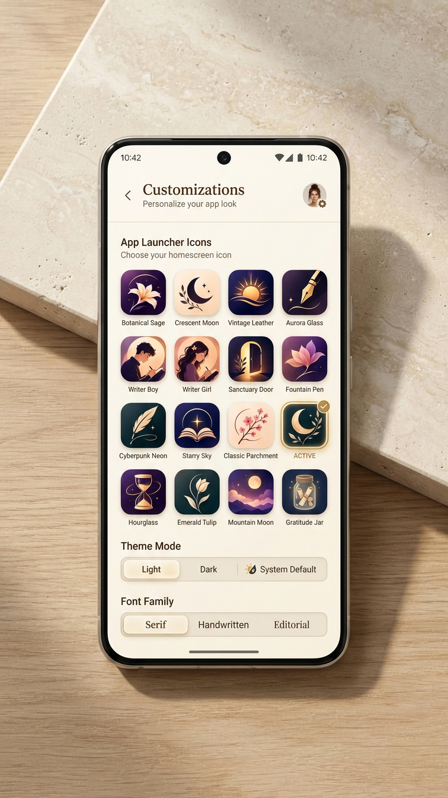
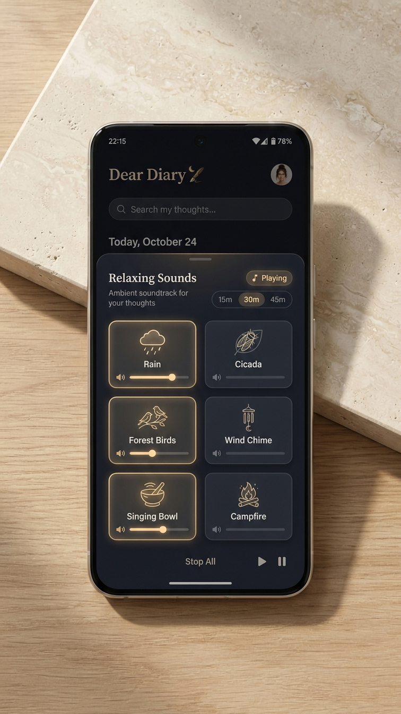

# 📔 Dear Diary — Vintage Frosted Glass Journal & AI Companion

[](https://github.com/B-max12/dear_diary)
[](https://flutter.dev)
[](https://github.com/B-max12/dear_diary/releases)
[](LICENSE)
[](https://github.com/B-max12/dear_diary)

> **A tranquil, privacy-first personal sanctuary crafted with frosted glassmorphism, 31 StoryPad structured writing templates, real-time device-to-device (D2D) sync, WhatsApp-style Google Drive cloud backup, 15 dynamic launcher icons, 25 ambient relaxation tracks, lifetime wax seal locking, and Safina AI reflection.**

Repository: [https://github.com/B-max12/dear_diary.git](https://github.com/B-max12/dear_diary.git)

---

## 📸 Visual Showcase & Interface Preview

<p align="center">
  
</p>

| 📱 Frosted Glass Timeline | 📝 StoryPad Templates | 🎨 Customization Studio |
| :---: | :---: | :---: |
|  |  |  |

| ✍️ Docked Rich Text Editor | 🎵 Ambient Sounds Mixer | ☁️ WhatsApp-Style Backup |
| :---: | :---: | :---: |
|  |  |  |

---

## ✨ Key Highlights in v5.0.0

- 🪟 **Complete Frosted Glassmorphism UI**: High-fidelity optical blurs (`BackdropFilter`), dual-mode translucent gradient containers (light & dark parchment glass), subtle specular rim highlights, and tactile 3D polymorphic buttons.
- 📋 **StoryPad Writing Templates Suite (31 Templates across 7 Categories)**: Instant structured prompt sheets for *Daily Reflection*, *Gratitude*, *Productivity*, *Wellness*, *Creative*, *Travel*, and *Special Days*. Seamless 1-tap insert & replace in the editor.
- ⚡ **Real-Time Device-to-Device (D2D) Sync**: Type on your phone and see your text update simultaneously on desktop in real-time over Wi-Fi and mobile data via Supabase Realtime broadcast channels.
- 💾 **WhatsApp-Style Full Cloud Backup & Restore**: Effortless 1-tap GZip-compressed backup to your private Google Drive `appDataFolder`. Restores every entry, tag, mood, photo, voice note, video, document, Gratitude Jar, and Time Capsule exactly as you left it.
- 📱 **15 Custom App Launcher Icons & Live App Renaming**: Choose from 15 custom handcrafted icon designs and custom app names that immediately update your Android home screen launcher via dynamic `<activity-alias>` switches.
- 🪟 **Android 8+ Floating Window & Split-Screen Multi-Tasking**: Fully responsive layout optimized for multi-window and floating popups without blank screen rendering glitches (Impeller disabled on floating surfaces).
- 🪶 **Optimized APK Footprint**: Losslessly compressed from 205MB down to **108.5MB** through automated palette-optimized GIF encoding and asset pruning.
- 🎵 **25-Track StoryPad Relaxing Sounds & Mixer**: Layer rain, forest birds, wind chimes, waves, and campfire with individual volume sliders, sleep timer, and live floating music pill.
- 🔒 **Zero-Knowledge Privacy & Lifetime Wax Seal Stamping**: AES-256 client-side encryption for confidential notes and physical wax seal simulation that permanently locks pages into immutable read-only records.

---

## 🎨 AI Screenshot Generation Prompts

Want to generate high-resolution mockups to include in your repository's `docs/screenshots/`? Use these exact, professionally engineered image prompts in Midjourney, DALL-E 3, or Flux:

<details>
<summary><b>Click to expand AI prompts for all 10 core screens</b></summary>

### 1. Home Timeline (Glassmorphic Vintage)
> `Modern Android smartphone mockup, displaying a calm personal journal app interface called 'Dear Diary'. Beautiful frosted glassmorphism aesthetic with translucent glass cards, BackdropFilter blur, soft warm cream paper texture underneath, delicate gold rim borders, subtle diffuse shadows. Displaying today's entries with animated mood emojis, glowing day-color indicator strips, and floating tactile 3D glass action buttons. Warm parchment aesthetic meets ultra-clean luxury UI design, 8k resolution, photorealistic studio lighting, Behance trending UI/UX.`

### 2. StoryPad Writing Templates Sheet
> `Mobile app bottom modal sheet UI mockup showing a StoryPad-inspired 'Writing Templates' gallery. Sleek frosted glass background with high blur, category filter chips (Daily Reflection, Gratitude, Growth, Wellness, Creative, Travel, Special Days) with pastel glow. Glass cards displaying template cards with hand-drawn line-art emojis, titles like '5-Minute Journal', 'Evening Wind-Down', and 'Weekly Review', with neat tonal 'Use Template' action buttons. Elegant typography, clean typography, luxury iOS and Android design.`

### 3. Entry Editor with Docked Glass Toolbar
> `Close-up shot of a smartphone running a vintage digital diary editor. Vintage lined cream paper background with handwritten serif font. A bottom docked frosted glass toolbar floats right above the digital keyboard, containing glossy tactile icons for Bold, Italic, 2-Tier Color Picker, Unified Media (Camera, Mic, Video, Document), Wax Seal Stamp, and GPS Location Pin. Translucent amber and slate accents, crisp high-end product render.`

### 4. 2-Tier 100-Shade Color Palette Sheet
> `Smartphone screen displaying an innovative 2-tier color picker sheet. Frosted glass card showing 10 base color family circles (Black, Crimson Red, Tangerine Orange, Amber Gold, Forest Green, Teal, Sapphire Blue, Purple, Soft Rose, Sepia Brown). Directly underneath, a horizontal row of 10 calibrated shades of the selected family from light tint to deep shade. Minimalist, modern UI design, Apple Human Interface inspired.`

### 5. Relaxing Ambient Sounds Mixer
> `A dark-mode mobile UI bottom sheet for 'Relaxing Sounds' with a cozy ambient aesthetic. Grid of frosted translucent square tiles with minimalist icons for Rain, Cicada, Forest Birds, Wind Chime, Singing Bowl, and Campfire. Active tracks have a glowing amber rim and smooth volume slider underneath. Header shows a floating music note pill and sleep timer button (15m, 30m, 45m). Cozy night vibe, warm lighting, Figma showcase render.`

### 6. Customization Studio & 15 Launcher Icons
> `Smartphone settings screen titled 'Customizations'. Featuring an interactive 4-column responsive grid showcasing 15 different app launcher icons (Botanical Sage, Vintage Leather, Aurora Glass, Cyberpunk Neon, Starry Sky, Classic Parchment, Emerald Luxe). Includes sleek segment controls for Theme Mode (Light, Dark, System Default with split sun/moon icon) and Font Family selections. Clean, tactile, polished design.`

### 7. 3D Wax Seal Workshop & Gratitude Jar
> `Split view of two signature keepsake features in a mobile diary app: On the left, an antique glass Gratitude Jar filled with tied parchment scrolls that roll and drop into the jar. On the right, a 3D Wax Seal workshop where molten red and burgundy wax is stamped with an ornate monogram seal badge to permanently lock an entry forever. Tangible, nostalgic, vintage luxury craftsmanship, photorealistic.`

### 8. WhatsApp-Style Google Drive Backup & Storage Management
> `Smartphone settings screen for 'Data & Cloud Backup'. Clean card with official Google Drive logo, animated sync status badge, last backup timestamp, and a segmented storage bar showing Local Database (Drift SQLite), Voice Notes, Photos, and Videos. Two tactile glass buttons: 'Back Up Now' (cloud upload icon) and 'Restore Backup'. Security badge below: 'Zero-Knowledge End-to-End Encryption'. Trustworthy, modern fintech-grade UX.`

### 9. World Footsteps Map & GPS Journey
> `Full-screen mobile app interface displaying a vintage-style illustrated world map with custom warm-toned pins marking diary memories. A transparent frosted glass app bar floats on top with a search field and a map style switcher (Streets / Vintage Satellite / Terrain). Bottom card previews the memory pinned at that location with a photo thumbnail, date, and journal snippet. Adventure, travel log, National Geographic inspired.`

### 10. Safina AI Companion Chat Screen
> `Conversational AI reflection screen named 'Safina'. Calm, poetic chat interface with soft warm message bubbles, gentle serif typography, and reflective prompts like 'How did today feel in your heart?'. Frosted glass input bar at the bottom with fountain pen write icon. No coding, no robotic elements; feels like confiding in a wise, timeless lifelong mentor. Serene, emotional wellbeing, Behance top design.`

</details>

---

## 🏗️ Technical Architecture

Dear Diary is engineered from the ground up for **extreme offline resilience, multi-platform fluidity, and uncompromising privacy**:

```
┌────────────────────────────────────────────────────────────────────────┐
│                        Dear Diary Client (Local)                       │
│                                                                        │
│   Flutter UI Layer (Frosted Glassmorphism, Quill Editor, 3D Docks)     │
│        │                                                               │
│        ▼                                                               │
│   Riverpod State Layer (Customizations, SyncEngine, RelaxingSounds)    │
│        │                                                               │
│        ▼                                                               │
│   Local SQLite Database (Drift Engine) ◄── PRIMARY SOURCE OF TRUTH    │
│   Local Media Storage   (Encrypted / Scaled Filesystem Cache)          │
└───────────────────┬───────────────────────────────┬────────────────────┘
                    │                               │
        Realtime Keystroke CDC           GZip Full Snapshot Sync
                    │                               │
                    ▼                               ▼
      ┌───────────────────────────┐   ┌───────────────────────────┐
      │  Supabase Cloud (Remote)  │   │     Google Drive Cloud    │
      │  • Hardware-backed JWT    │   │  • appDataFolder Sandbox  │
      │  • Realtime Broadcast     │   │  • Encrypted .json.gz     │
      │  • Row Level Security     │   │  • Zero-Quota Footprint   │
      └───────────────────────────┘   └───────────────────────────┘
```

### Architectural Principles:
1. **Local-First Supremacy**: Every keystroke, photo, voice recording, and tag is instantly written to local SQLite via Drift and the device filesystem. The app opens and functions instantly with zero network connectivity.
2. **Real-Time Cross-Device Broadcasting**: Uses Supabase Realtime WebSocket broadcast channels to reflect drafts and committed edits across phones and desktops instantaneously.
3. **WhatsApp-Style Portable Cloud Snapshots**: Full diary state (entries, tags, moods, attachments, jars, time capsules, and settings) is bundled into compact GZip `.json.gz` archives and stored in your own Google Drive application sandbox.
4. **Permanent Immutability**: Wax-sealed records cannot be edited or altered after stamping, guaranteed both locally in SQLite and remotely via PostgreSQL triggers.

---

## 📂 Project Structure

```
dear_diary/
├── android/                  # Android native project, activity-aliases & manifest
├── assets/
│   ├── app_icons/            # 15 custom launcher icon assets
│   ├── icons/                # Compressed animated GIF icon collection (4.1MB)
│   ├── images/               # Paper textures, wax seals, and illustrations
│   └── sounds/               # Bundled offline ambient sound fallbacks
├── lib/
│   ├── core/                 # Routing, theme, localization, constants, and utilities
│   ├── data/                 # Drift SQLite database, repositories, and sync engine
│   ├── domain/               # Entities (WritingTemplate, Customizations, Entries)
│   ├── presentation/
│   │   ├── controllers/      # Riverpod controllers & state notifiers
│   │   ├── providers/        # Dependency injection & reactive providers
│   │   ├── screens/
│   │   │   ├── diary/        # Entry editor & entry list screens
│   │   │   ├── home/         # HomeShell, bottom bar dock & TodayScreen
│   │   │   ├── map/          # World Footsteps interactive map
│   │   │   ├── settings/     # Customizations, Data & Backup, Storage screens
│   │   │   └── templates/    # StoryPad Templates Hub & Custom Editor
│   │   └── widgets/          # Glassmorphic EntryCard, Toolbar, Sound mixer, Sheets
│   └── services/             # Audio, AI (Safina), Google Drive, and Security
├── test/                     # Unit, widget, and integration test suites
└── pubspec.yaml              # Dependencies and asset declarations
```

---

## 🚀 Getting Started & Installation

### Prerequisites
- **Flutter SDK**: `>= 3.24.0`
- **Dart SDK**: `>= 3.5.0`
- **Android SDK**: `API Level 26+` (Android 8.0 Oreo or higher)

### Setup Instructions

1. **Clone the repository**:
   ```bash
   git clone https://github.com/B-max12/dear_diary.git
   cd dear_diary
   ```

2. **Install Flutter dependencies**:
   ```bash
   flutter pub get
   ```

3. **Verify analyzer health**:
   ```bash
   flutter analyze
   ```
   *(Ensure 0 warnings and 0 errors).*

4. **Run the test suite**:
   ```bash
   flutter test
   ```

5. **Run the app locally**:
   ```bash
   flutter run
   ```

### 📦 Building Release APK

To generate the production release APK (optimized under 120MB):

```bash
flutter build apk --release
```

The compiled APK will be located at:
```
build/app/outputs/flutter-apk/app-release.apk
```

---

## 📜 Complete Feature Catalog

<details>
<summary><b>Click to expand the 12 feature suites in Dear Diary</b></summary>

### 1. 🖋️ Core Journaling & Frosted Glass Dashboard
- **Glassmorphic Timeline**: Chronological memory feed with frosted glass cards, day-color glows, and smooth scroll retention.
- **StoryPad Writing Templates**: 31 pre-built structured templates across 7 categories (Daily Reflection, Gratitude, Growth, Wellness, Creative, Travel, Special Days) with 1-tap insert and replace.
- **Bottom Docked RichTextToolbar**: Docked right above the mobile keyboard with Bold, Italic, Underline, Strikethrough, Heading styles, Quotes, Checklists, Undo/Redo, and 100-shade color picker.
- **Unified Media Attachment**: Single button to embed Photos, Voice Notes, High-Res Videos, and Documents (PDF, Word, Excel, TXT) inline into entries.

### 2. 🎵 25-Track Ambient Sound Studio
- **Curated Atmosphere**: Rain, Thunderstorm, Ocean Waves, Stream, Forest Birds, Night Crickets, Wind Chime, Singing Bowl, Campfire, Old Café, White Noise, and more.
- **Multi-Track Mixing**: Play up to 5 tracks simultaneously with custom volume levels per track.
- **Sleep Timer**: Auto-fade timers (15m, 30m, 45m, 60m) with live countdown in the floating header pill.

### 3. 🏺 Keepsakes & Nostalgia
- **Gratitude Jar**: Animated tied parchment scroll drops into an antique jar; jars automatically seal at 200 notes onto a wooden Past Jars shelf.
- **Time Capsules**: Letters to your future self with countdown timer, wax seal lock, and threaded reply upon unlocking.
- **Letters to God / Universe**: Spiritual reflections encrypted client-side with zero-knowledge AES-256 ciphers.
- **Lifetime Wax Seal Stamping**: Permanently lock any entry into an uneditable archival heirloom with a vintage wax badge.

### 4. 🧭 World Footsteps Map & Navigation
- **Interactive Offline Map**: Search places, drop coordinates, and tag diary memories to real-world locations.
- **Memory Hotspots**: Visual cluster markers showing where life's stories occurred around the globe.

### 5. 🤖 Safina AI Life Companion
- **Empathetic Mentor Persona**: Private reflections tailored to your journal context without ever providing robotic or coding responses.
- **Emotional Wave Arc**: Visual mood tracking, psychological valence patterns, and habit-happiness correlations.

### 6. 📱 Customizations & Personalization
- **15 App Launcher Icons**: Botanical Sage, Espresso Leather, Aurora Glass, Cyberpunk Neon, Starry Sky, and more that change live on your phone.
- **Custom App Name**: Disguise or rename your diary on your home screen.
- **Typography Suite**: Multiple font families (Classic Serif, Modern Sans, Vintage Mono), font weights, and adjustable sizing.
- **Day Colors**: Custom accent tints for every day of the week (Monday through Sunday).

</details>

---

## 🤝 Contributing

Contributions, bug reports, and suggestions are welcome!
1. Fork the Project.
2. Create your Feature Branch (`git checkout -b feature/AmazingFeature`).
3. Commit your Changes (`git commit -m 'Add some AmazingFeature'`).
4. Push to the Branch (`git push origin feature/AmazingFeature`).
5. Open a Pull Request.

---

## 📄 License & Credits

Distributed under the MIT License. See `LICENSE` for more information.

- **Developer & Creator**: Awab Hamdan / [AUR LABs](https://aurlabs.online/)
- **Repository**: [https://github.com/B-max12/dear_diary.git](https://github.com/B-max12/dear_diary.git)
- **Special Thanks**: The StoryPad open-source project for inspiration on calm digital journaling.
